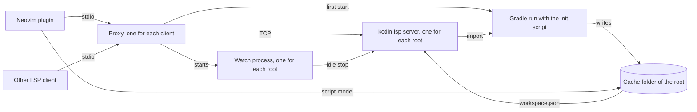

# Architecture

Each LSP client starts its own `kotlin-lsp` proxy. The proxies of a Gradle root share one
kotlin-lsp server. The server stays after the last client exits, until the idle stop.

## Processes

| Process | Work |
| --- | --- |
| Proxy | Finds the root and copies the LSP messages. If no server runs, it starts one. After a failed import, it starts the next import. |
| kotlin-lsp server | Analyzes the Kotlin code. It reads the library sources from `workspace.json`. |
| Gradle run | Runs the init script `gradle/lsp-library-sources.gradle`: before the first server start, after `variant set`, and in each server import. It writes the library sources, the variants, and the `R` jars. |
| Watch process | Stops the server after 1 hour with no client. Writes the init script again after kotlin-lsp deletes it. |
| Neovim plugin | Restarts the client after `variant set`, moves library locations to sources, and does the name lookup in `.gradle.kts` files. |

## Cache folder

The cache root is `$KOTLIN_LSP_CACHE`. The default is `~/.cache/kotlin-lsp`. Each Gradle root has
the folder `<cache root>/<key>/`. The key is the first 12 hex characters of `sha256(root path)`.

| File | Content |
| --- | --- |
| `<key>/server.log` | Log of the server. Each server start empties it. |
| `<key>/watch.log` | Log of the watch process |
| `<key>/variant` | The variant that `variant set` saved |
| `<key>/variants.json` | The variants of each module |
| `<key>/library-sources/workspace.json` | The libraries with their sources, for the server |
| `<key>/library-sources/gradle-scripts.json` | The Gradle script model |
| `download.log` | Log of the background downloads of the Android SDK and Gradle sources |

## Measurements

In [nowinandroid](https://github.com/android/nowinandroid):

| Step | Time or size |
| --- | --- |
| New server start, until the server is ready | about 15 s |
| Memory of a server | about 1.5 GB |
| First definition result, with a warm-up | 1.9 s |
| First definition result, without a warm-up | 4.7 s |
| `R` jars, with a warm Gradle daemon and no changes (384 tasks of 32 modules) | about 2 s |
| `script-model`, with a running Gradle daemon | about 1 s |
